# SmartCollapse

Makes the taskbar's **Show desktop** button work **per monitor**. Click it and only the windows on
*that* monitor are minimized; click it again and exactly those windows come back. Your other monitors
are left alone.

<p align="center">
  
</p>

- Restores windows as they were: stacking order, maximized/normal state, positions, and focus.
- Open something from the desktop in between? The next click hides it too, and the click after that
  brings everything back.
- **Peek at desktop per monitor**: rest the cursor on the button and only that monitor shows its desktop
  (live, animated wallpapers included) until you move away.
- **Shift+click** gives you the original Windows behavior (all monitors).
- Optional **admin mode** that also hides windows of apps running as administrator.
- Aware of virtual desktops; skips frozen apps and never waits on them; remembers what it collapsed across
  its own restarts.
- Tiny: a ~250 KB native exe with no dependencies, ~2 MB of memory, no CPU use while idle.

## How it works

It doesn't touch Explorer: no DLL injection, no patching, no services or drivers.

SmartCollapse runs as a normal background app with a tray icon. A low-level mouse hook in its own
process looks at mouse input. A click is taken over only when it lands on a Show desktop button. The
press and release are swallowed, so Explorer never sees them. Everything else passes through untouched.
The windows on that monitor are then minimized and restored with the same public window APIs the
taskbar itself uses. The per-monitor peek is a click-through overlay showing a live DWM thumbnail of the
desktop; no window is moved or changed for it.

Pause or quit SmartCollapse and the button behaves exactly as before.

## Compatibility

| Taskbar | Status |
| --- | --- |
| StartAllBack, ExplorerPatcher, Windows 10 (classic taskbar) | Supported. The button is located by its window class on every taskbar that has one, in any position. |
| Windows 11 native taskbar | Supported. The button is located through UI Automation. If it isn't found, the click keeps its normal behavior. |

Tested on Windows 11 25H2 with the native taskbar and with StartAllBack 3.9, plus Wallpaper Engine: three
monitors with different DPI scaling (with StartAllBack, one horizontal and two vertical taskbars).

## Usage

Run `SmartCollapse.exe`. On first start it registers itself to start with Windows (per user). The tray
icon menu has:

- **Enabled**: pause/resume (the paused icon is gray).
- **Peek at desktop on hover**: the per-monitor peek.
- **Start with Windows**.
- **Escalate to admin** / **Running as admin**: see below.
- **About SmartCollapse**.
- **Exit**.

Command line:

```
SmartCollapse.exe --toggle [N]   collapse/restore monitor N (\\.\DISPLAYN); default: the one under the cursor
SmartCollapse.exe --exit         stop the running instance
SmartCollapse.exe --log          write diagnostics to %TEMP%\SmartCollapse.log
```

`--toggle` is handy for binding a per-monitor "show desktop" to a hotkey or a mouse button in other tools.

### Admin mode

Windows doesn't let a normal app minimize the windows of apps running as administrator (WireGuard, an
elevated Task Manager, ...). Without admin mode those windows simply stay where they are, and they don't
get in the way of collapsing or restoring the rest.

**Escalate to admin** restarts SmartCollapse with administrator rights after one UAC prompt. Its
autostart then moves from the Run key to a Task Scheduler task named `SmartCollapse` ("run with highest
privileges" at your sign-in), so there is no UAC prompt at every start. Clicking **Running as admin**
goes back to normal rights and to the Run key.

## Good to know

- Windows' own **Peek at desktop** fades out every window on every monitor while the cursor rests on the
  button. While its per-monitor peek is on, SmartCollapse switches Windows' peek off, and switches it back
  on when you pause SmartCollapse, untick *Peek at desktop on hover* or exit (only if it was on before). If
  you tick Windows' peek again yourself (right-click the button, then *Peek at desktop*), SmartCollapse
  leaves peeking to Windows, ends it as soon as you click, and keeps its own peek off until you tick
  *Peek at desktop on hover* again.
- **Win+D** keeps its usual all-monitors behavior. Only the button changes.
- Touch and pen taps on the button haven't been tested.

## Build

Requires Visual Studio 2022 (or its Build Tools) with the C++ workload.

```
build.cmd
```

The output is `build\SmartCollapse.exe`. `tools\make-icons.ps1` regenerates the icons in `res\`.

## Uninstall

If it runs as admin, click **Running as admin** first. Then untick **Start with Windows**, choose **Exit**,
and delete the exe. Exiting also gives Windows' peek back if SmartCollapse switched it off. Settings live
in `HKCU\Software\SmartCollapse`.

## Author

[zalexdev](https://github.com/zalexdev). Bugs and ideas:
[github.com/zalexdev/SmartCollapse/issues](https://github.com/zalexdev/SmartCollapse/issues).
